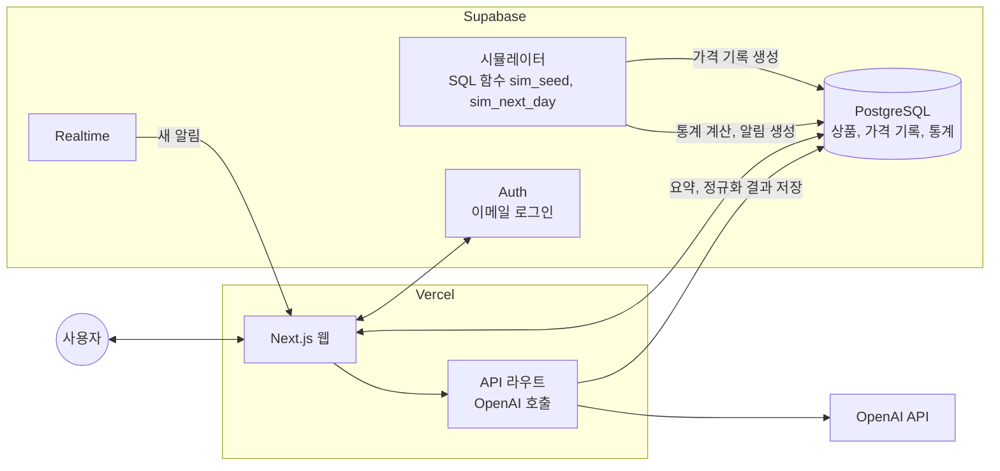

# 04. 시스템 설계

## 1. 기술 스택

| 영역 | 기술 | 선택 이유 |
|---|---|---|
| 프론트엔드 | **Next.js 15 (App Router) + TypeScript** | 웹 서비스에서 가장 많이 쓰이고, Vercel에 무료로 바로 배포된다. 난이도 평가에도 유리하다 |
| 스타일 | **Tailwind CSS** | CSS 파일을 따로 관리하지 않아도 되고 반응형을 쉽게 만든다 |
| 그래프 | **Recharts** | React용 그래프 라이브러리로 사용법이 쉽다 |
| DB, 로그인, 실시간 | **Supabase** (PostgreSQL, Auth, Realtime) | 서버 없이 DB, 이메일 로그인, 실시간 알림을 모두 제공한다. 무료 요금제 500MB |
| 데모 시뮬레이터 | **Supabase SQL 함수** (PostgreSQL) | 외부 서버, 키, 파이썬 환경이 필요 없고 DB 안에서 바로 테스트할 수 있다 |
| AI | **OpenAI API** (저가형 mini 모델) | 품번 정규화와 할인 요약 (평가 항목). Vercel의 API 라우트에서 호출한다. 상세는 `09_AI활용계획.md` |
| 배포 | **Vercel** | GitHub에 push하면 자동 배포된다 |

> 대안: React와 TypeScript가 부담되면 프론트를 **HTML, JS, Supabase JS**로만 만들어 GitHub Pages에 올릴 수 있습니다. DB와 시뮬레이터 설계는 그대로 씁니다. 다만 난이도와 완성도 점수에서 불리할 수 있습니다.

## 2. 전체 구조



**포인트:** 웹은 데이터가 가상인지 실제인지 모르고 테이블만 읽습니다. 그래서 시뮬레이터를 실제 수집기로 바꿔도 웹은 그대로 씁니다.

## 3. 데모 시뮬레이터

### 3.1 무엇을 만드는가
- 가상 브랜드 11개, 품목 23종 × 색 3가지 = **모델 69개**
- 가상 쇼핑몰 3곳(데모몰A/B/C)에 올린 **상품 171개** (모델마다 2~3곳)
- 상품마다 **90일치** 일별 가격 기록 (15,390건)
- 쇼핑몰마다 상품명 표기가 다르다. 데모몰C는 품번이 없어 `model_id`를 비워 두고, AI 정규화로 맞춘다 (`09_AI활용계획.md` F1)

### 3.2 가격 시나리오
상품마다 하나씩 정해진 규칙으로 배정합니다. 난수는 상품 번호로 고정해서 같은 입력이면 항상 같은 결과가 나옵니다.

| 시나리오 | 상품 수 | 가격 움직임 | 판정 |
|---|---|---|---|
| real 진짜 할인 | 65개 | 한동안 정가 → 1차 할인(정가의 88%) → 본 할인(60~75%). 하루 지나기 1~4일째에 최저가를 한 번 더 갱신 | 진짜 할인 |
| inflated 부풀림 | 46개 | 정가를 시장가의 1.8~2.4배로 부풀리고, 실제로는 늘 시장가 ±3%에 판다 | 부풀림 의심 |
| steady 보통 | 38개 | 정가의 96.5~98.5% 사이에서 조금씩 흔들린다 | 보통 |
| flash 반짝 특가 | 22개 | 평소엔 정가. 하루 지나기 1~2일째에 38% 특가, 3일째에 정가로 복귀 | 처음엔 보통, 특가 때 진짜 할인 |

### 3.3 사용법 (Supabase SQL Editor)
먼저 `schema.sql`, 다음에 `002_simulator.sql` 전체를 붙여 넣고 실행한 뒤 아래를 씁니다.
```sql
select sim_seed();          -- 가상 데이터와 90일치 가격 기록 생성 (처음 한 번)
select sim_next_day();      -- 하루 지나기 (시연용)
select sim_seed(90, true);  -- 데모 데이터를 지우고 처음부터 다시 만들기
```
`sim_next_day()` 내부 순서:
1. 모든 가상 상품의 다음 날 가격을 만들어 `price_history`에 넣는다.
2. `products.current_price`를 갱신한다.
3. `refresh_product_stats()`로 역대 최저가, 기준가, 신뢰도 등급을 다시 계산한다.
4. `generate_notifications()`로 관심 상품 조건을 검사해 알림을 만든다.
5. 결과(날짜, 새 최저가 수, 만든 알림 수)를 JSON으로 돌려준다.

웹에는 로그인한 사용자에게만 보이는 "하루 지나기" 버튼을 두고 `rpc('sim_next_day')`를 호출합니다. 권한은 `sim_seed`는 SQL Editor(관리자)만, `sim_next_day`는 로그인 사용자만, 통계·알림 함수는 웹에서 직접 호출할 수 없게 막았습니다.

### 3.4 검증 결과 (로컬 PostgreSQL 16)
- 시드: 모델 69, 상품 171, 가격 기록 15,390건, 0.6초
- 시드 직후 판정: 시나리오별로 기대한 등급이 **171개 모두 일치** (진짜 할인 65, 부풀림 의심 46, 보통 60)
- 하루 지나기 6번: 새 최저가 35 → 26 → 10 → 17 → 0 → 0건. 반짝 특가 상품은 이틀 뒤 "보통"으로 복귀
- 관심 상품 알림(목표가, 최저가 갱신) 생성, 같은 알림은 24시간 안에 중복 생성되지 않음
- `002_simulator.sql`을 두 번 실행해도 데이터가 중복되지 않음. 웹 역할(anon)은 시뮬레이터와 통계 함수를 호출할 수 없음
- **시연 팁:** 하루 지나기는 4번째까지 새 최저가가 나오고, 그 뒤로는 변화가 없습니다. 시연 전에 `sim_seed(90, true)`로 초기화하세요.

### 3.5 나중에 실제 수집기를 붙이려면
시뮬레이터는 `products`와 `price_history`에만 쓰고, 통계와 알림은 같은 함수를 씁니다. 실제 수집기(예: Python)는 이 두 테이블에 upsert한 뒤 `refresh_product_stats()`와 `generate_notifications()`를 호출하면 됩니다. 가상 데이터는 `is_demo = true`로 구분합니다. 소스마다 어댑터를 분리하는 구조가 알맞습니다.

## 4. 핵심 계산 로직

### 4.1 공식
| 지표 | 계산 |
|---|---|
| 현재가 | 가장 최근 `price_history.sale_price` |
| 역대 최저가 | `MIN(sale_price)` (전체 수집 기간) |
| 기준가 | 최근 30일 `sale_price`의 중앙값 (일 단위로 하루 1개 값으로 묶은 뒤 계산) |
| 표시 할인율 | (정가 − 현재가) ÷ 정가 |
| 실질 할인율 | (기준가 − 현재가) ÷ 기준가 |
| 정가 판매일 비율 | `sale_price ≥ list_price × 0.98`인 날 수 ÷ 수집한 날 수 |
| 수집 일수 | 서로 다른 수집 날짜 수 |

### 4.2 할인 신뢰도 판정 (위에서부터 먼저 걸리는 것)
| 순서 | 조건 | 등급 | 화면 문구 |
|---|---|---|---|
| 1 | 수집 일수 < 7 | **데이터 부족** | "수집 N일째, 판단하기엔 아직 일러요" |
| 2 | 표시 할인율 ≥ 30% **그리고** 정가 판매일 비율 < 10% **그리고** 실질 할인율 < 5% | **부풀림 의심** | "정가로 팔린 날이 거의 없어요. 사실상 평소 가격이에요" |
| 3 | 실질 할인율 ≥ 10% **또는** (현재가 ≤ 역대 최저가 × 1.02 **그리고** 실질 할인율 ≥ 3%) | **진짜 할인** | "평소보다 N% 싸요" 또는 "역대 최저가예요" |
| 4 | 그 밖 | **보통** | "평소 가격과 비슷해요" |

예시 (로컬 PostgreSQL로 검증한 결과):

| 상황 | 결과 |
|---|---|
| 정가 199,000원, 14일 내내 79,000원 (표시 60%) | 정가 판매일 0%, 실질 0% → **부풀림 의심** |
| 위 상품이 다음 날 69,000원으로 하락 | 실질 13% → **진짜 할인** (평소 79,000원보다 싸졌으므로) |
| 정가 139,000원으로 12일 판매 후 89,000원 | 정가 판매일 86%, 실질 36% → **진짜 할인** |
| 할인 없이 계속 39,000원 | **보통** |
| 수집 3일째 | **데이터 부족** |

### 4.3 SQL로 구현
통계는 파이썬이 아니라 DB 안의 함수(`refresh_product_stats()`)로 계산합니다. 데이터를 웹으로 옮기지 않아 빠르고, 코드는 `supabase/schema.sql`에 있습니다.

## 5. 알림 로직
```
관심 상품(watchlist)마다:
  현재가 ≤ 목표가               → type='target_price'
  이번 수집에서 역대 최저가 갱신  → type='all_time_low'
  같은 (사용자, 상품, type) 알림이 24시간 안에 있으면 건너뜀
```
- 웹은 Supabase Realtime으로 `notifications` 테이블에서 **내 알림이 추가되는 것만** 구독해, 종 아이콘 숫자를 바로 올립니다.

## 6. 웹 구조 (Next.js)
```
web/
├─ app/
│  ├─ page.tsx                 # 홈 = 할인 목록
│  ├─ products/[id]/page.tsx   # 상세
│  ├─ login/page.tsx
│  ├─ signup/page.tsx
│  ├─ me/wishlist/page.tsx
│  ├─ me/watchlist/page.tsx
│  └─ me/notifications/page.tsx
├─ components/
│  ├─ ProductCard.tsx
│  ├─ PriceTriple.tsx          # 현재가·정가·역대 최저가 묶음
│  ├─ TrustBadge.tsx
│  ├─ PriceChart.tsx
│  ├─ WishButton.tsx
│  ├─ WatchDialog.tsx
│  └─ NotificationBell.tsx
└─ lib/supabase.ts
```

## 7. 보안
| 항목 | 방법 |
|---|---|
| 비밀번호 | Supabase Auth가 bcrypt로 암호화해 저장한다. 직접 저장하지 않는다 |
| 데이터 접근 | 모든 사용자 테이블에 RLS(행 수준 보안)를 켠다. `user_id = auth.uid()`인 행만 읽고 쓴다 |
| 키 관리 | 웹 브라우저는 공개용 `anon` 키만 쓴다. `service_role` 키와 OpenAI 키는 Vercel 서버 환경변수에만 두고 API 라우트에서만 쓴다 |
| 상품 데이터 | 누구나 읽을 수 있지만, 쓰기는 시뮬레이터 함수와 service_role만 가능하다. 통계·알림 함수는 웹에서 직접 호출할 수 없다 |

## 8. 무료 한도 점검
| 서비스 | 무료 한도 (2026-11 기준, 개발 시작 시 재확인) | 예상 사용량 |
|---|---|---|
| Supabase | DB 500MB, 활동 없으면 7일 뒤 일시정지 | 5MB 안팎. 7일 이상 쉬면 정지되므로 시연 전에 한 번 접속해 깨운다 |
| Vercel Hobby | 개인 비상업용 무료 | 충분 |
| OpenAI | 유료 (선불 크레딧) | 정규화 약 58개, 요약은 상품당 1번만 만들어 저장하므로 수천 원 이내 예상 |
