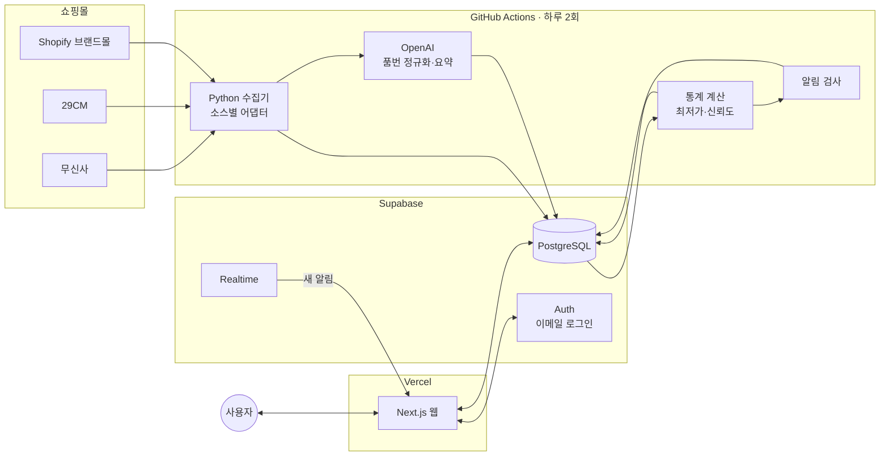

# 04. 시스템 설계

## 1. 기술 스택

| 영역 | 기술 | 선택 이유 |
|---|---|---|
| 프론트엔드 | **Next.js 15 (App Router) + TypeScript** | 웹 서비스에서 가장 많이 쓰이고, Vercel에 무료로 바로 배포된다. 난이도 평가에도 유리하다 |
| 스타일 | **Tailwind CSS** | CSS 파일을 따로 관리하지 않아도 되고 반응형을 쉽게 만든다 |
| 그래프 | **Recharts** | React용 그래프 라이브러리로 사용법이 쉽다 |
| DB, 로그인, 실시간 | **Supabase** (PostgreSQL, Auth, Realtime) | 서버 없이 DB, 이메일 로그인, 실시간 알림을 모두 제공한다. 무료 요금제 500MB |
| 수집기 | **Python 3.12** + `requests` + `supabase-py` | 이미 써본 언어. 크롤링 자료가 가장 많다 |
| 자동 실행 | **GitHub Actions** (cron) | 서버 없이 정해진 시간에 파이썬을 실행한다. 공개 저장소는 무료 |
| AI | **OpenAI API** (저가형 mini 모델) | 품번 정규화와 할인 요약 (평가 항목). 상세는 `09_AI활용계획.md` |
| 배포 | **Vercel** | GitHub에 push하면 자동 배포된다 |

> 대안: React와 TypeScript가 부담되면 프론트를 **HTML, JS, Supabase JS**로만 만들어 GitHub Pages에 올릴 수 있습니다. DB와 수집기 설계는 그대로 씁니다. 다만 난이도와 완성도 점수에서 불리할 수 있습니다.

## 2. 전체 구조



**포인트:** 웹은 쇼핑몰에 직접 요청하지 않습니다. 쇼핑몰에 요청하는 것은 수집기뿐이고, 웹은 Supabase DB만 읽습니다. 그래서 서버가 없어도 됩니다.

## 3. 수집 파이프라인

### 3.1 폴더 구조
```
crawler/
├─ main.py              # 실행 진입점: 모든 어댑터 → 저장 → 통계 → 알림
├─ adapters/
│  ├─ base.py           # 공통 인터페이스 (fetch_products)
│  ├─ musinsa.py
│  ├─ cm29.py
│  └─ shopify.py        # 여러 Shopify몰을 설정 목록으로 처리
├─ normalize.py         # 카테고리 매핑, 품번 추출 (정규식 → 실패 시 OpenAI)
├─ store.py             # Supabase upsert
├─ stats.py             # 역대 최저가, 기준가, 신뢰도 계산
├─ notify.py            # 관심 상품 조건 검사 → 알림 생성
└─ requirements.txt
.github/workflows/crawl.yml
```

### 3.2 어댑터 인터페이스
```python
# crawler/adapters/base.py
from dataclasses import dataclass

@dataclass
class RawProduct:
    platform: str          # 'musinsa' | '29cm' | 'shopify:<브랜드>'
    external_id: str       # 쇼핑몰 상품번호
    name: str
    brand: str
    category_raw: str
    list_price: int        # 정가 (원)
    sale_price: int        # 판매가 (원)
    image_url: str
    product_url: str
    is_soldout: bool

class BaseAdapter:
    platform: str
    def fetch_products(self) -> list[RawProduct]:
        raise NotImplementedError
```

### 3.3 실행 순서
1. 어댑터마다 `fetch_products()`를 부른다. 예외가 나면 기록하고 다음 어댑터로 넘어간다.
2. `products` 테이블에 upsert한다. 키는 (platform, external_id)이다.
3. `price_history`에 오늘 가격을 upsert한다 (상품 × 날짜 = 1행, 하루 2회 수집 중 낮은 가격을 남긴다).
4. `stats.py`로 `product_stats`를 갱신한다 (SQL 함수 `refresh_product_stats()` 호출).
5. `notify.py`로 관심 상품 조건을 검사하고 `notifications`에 넣는다.
6. `crawl_runs`에 실행 결과를 기록한다.

### 3.4 자동 실행 (GitHub Actions)
```yaml
# .github/workflows/crawl.yml
name: crawl
on:
  schedule:
    - cron: "0 0,12 * * *"   # UTC 00:00, 12:00 = KST 09:00, 21:00
  workflow_dispatch: {}       # 수동 실행 버튼
jobs:
  run:
    runs-on: ubuntu-latest
    timeout-minutes: 60
    steps:
      - uses: actions/checkout@v4
      - uses: actions/setup-python@v5
        with: { python-version: "3.12" }
      - run: pip install -r crawler/requirements.txt
      - run: python crawler/main.py
        env:
          SUPABASE_URL: ${{ secrets.SUPABASE_URL }}
          SUPABASE_SERVICE_KEY: ${{ secrets.SUPABASE_SERVICE_KEY }}
          OPENAI_API_KEY: ${{ secrets.OPENAI_API_KEY }}
```
- **해외 IP 차단 대책:** GitHub Actions 서버는 해외에 있습니다. 쇼핑몰이 해외 IP를 막으면 같은 `main.py`를 **본인 PC의 Windows 작업 스케줄러**로 하루 2회 돌립니다. 코드는 바꿀 필요가 없습니다.
- 참고: GitHub의 cron은 몇 분에서 수십 분 늦게 실행될 수 있습니다. 이 서비스에는 문제가 되지 않습니다.

## 4. 핵심 계산 로직

### 4.1 공식
| 지표 | 계산 |
|---|---|
| 현재가 | 가장 최근 `price_history.sale_price` |
| 역대 최저가 | `MIN(sale_price)` (전체 수집 기간) |
| 기준가 | 최근 30일 `sale_price`의 중앙값 (일 단위로 하루 1개 값으로 묶은 뒤 계산) |
| 표시 할인율 | (정가 − 현재가) ÷ 정가 |
| 실질 할인율 | (기준가 − 현재가) ÷ 기준가 |
| 정가 판매일 비율 | `sale_price ≥ list_price × 0.98`인 날 수 ÷ 수집한 날 수 |
| 수집 일수 | 서로 다른 수집 날짜 수 |

### 4.2 할인 신뢰도 판정 (위에서부터 먼저 걸리는 것)
| 순서 | 조건 | 등급 | 화면 문구 |
|---|---|---|---|
| 1 | 수집 일수 < 7 | **데이터 부족** | "수집 N일째, 판단하기엔 아직 일러요" |
| 2 | 표시 할인율 ≥ 30% **그리고** 정가 판매일 비율 < 10% **그리고** 실질 할인율 < 5% | **부풀림 의심** | "정가로 팔린 날이 거의 없어요. 사실상 평소 가격이에요" |
| 3 | 실질 할인율 ≥ 10% **또는** (현재가 ≤ 역대 최저가 × 1.02 **그리고** 현재가 < 기준가) | **진짜 할인** | "평소보다 N% 싸요" 또는 "역대 최저가예요" |
| 4 | 그 밖 | **보통** | "평소 가격과 비슷해요" |

예시 (로컬 PostgreSQL로 검증한 결과):

| 상황 | 결과 |
|---|---|
| 정가 199,000원, 14일 내내 79,000원 (표시 60%) | 정가 판매일 0%, 실질 0% → **부풀림 의심** |
| 위 상품이 다음 날 69,000원으로 하락 | 실질 13% → **진짜 할인** (평소 79,000원보다 싸졌으므로) |
| 정가 139,000원으로 12일 판매 후 89,000원 | 정가 판매일 86%, 실질 36% → **진짜 할인** |
| 할인 없이 계속 39,000원 | **보통** |
| 수집 3일째 | **데이터 부족** |

### 4.3 SQL로 구현
통계는 파이썬이 아니라 DB 안의 함수(`refresh_product_stats()`)로 계산합니다. 데이터를 웹으로 옮기지 않아 빠르고, 코드는 `supabase/schema.sql`에 있습니다.

## 5. 알림 로직
```
관심 상품(watchlist)마다:
  현재가 ≤ 목표가               → type='target_price'
  이번 수집에서 역대 최저가 갱신  → type='all_time_low'
  같은 (사용자, 상품, type) 알림이 24시간 안에 있으면 건너뜀
```
- 웹은 Supabase Realtime으로 `notifications` 테이블에서 **내 알림이 추가되는 것만** 구독해, 종 아이콘 숫자를 바로 올립니다.

## 6. 웹 구조 (Next.js)
```
web/
├─ app/
│  ├─ page.tsx                 # 홈 = 할인 목록
│  ├─ products/[id]/page.tsx   # 상세
│  ├─ login/page.tsx
│  ├─ signup/page.tsx
│  ├─ me/wishlist/page.tsx
│  ├─ me/watchlist/page.tsx
│  └─ me/notifications/page.tsx
├─ components/
│  ├─ ProductCard.tsx
│  ├─ PriceTriple.tsx          # 현재가·정가·역대 최저가 묶음
│  ├─ TrustBadge.tsx
│  ├─ PriceChart.tsx
│  ├─ WishButton.tsx
│  ├─ WatchDialog.tsx
│  └─ NotificationBell.tsx
└─ lib/supabase.ts
```

## 7. 보안
| 항목 | 방법 |
|---|---|
| 비밀번호 | Supabase Auth가 bcrypt로 암호화해 저장한다. 직접 저장하지 않는다 |
| 데이터 접근 | 모든 사용자 테이블에 RLS(행 수준 보안)를 켠다. `user_id = auth.uid()`인 행만 읽고 쓴다 |
| 키 관리 | 웹은 공개용 `anon` 키만 쓴다. 쓰기 권한이 있는 `service_role` 키는 GitHub Secrets에만 두고 수집기에서만 쓴다 |
| 상품 데이터 | 누구나 읽을 수 있지만, 쓰기는 수집기(service_role)만 가능하다 |

## 8. 무료 한도 점검
| 서비스 | 무료 한도 (2026-11 기준, 개발 시작 시 재확인) | 예상 사용량 |
|---|---|---|
| Supabase | DB 500MB, 활동 없으면 7일 뒤 일시정지 | 약 300MB (5절 계산) / 하루 2회 수집이라 정지되지 않음 |
| GitHub Actions | 공개 저장소 무료 | 1회 10~30분 |
| Vercel Hobby | 개인 비상업용 무료 | 충분 |
| OpenAI | 유료 (선불 크레딧) | 신규 상품만 정규화하므로 수천 원 이내 예상 |
