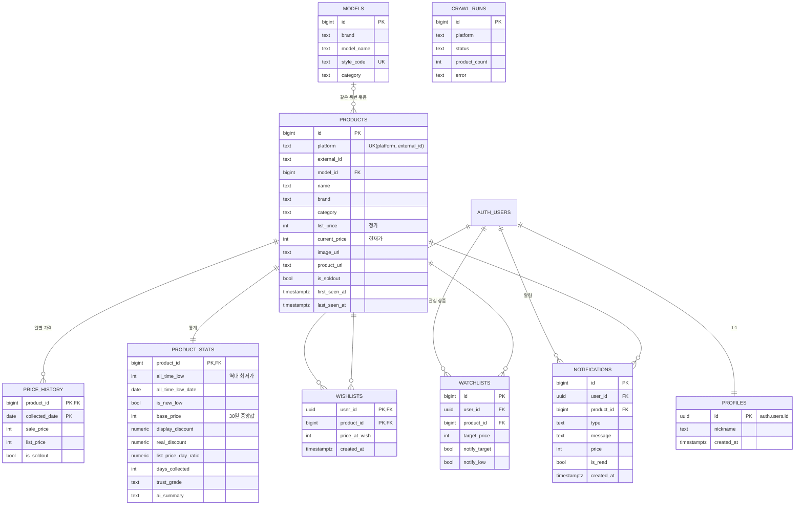

# 05. DB 설계

- DBMS: Supabase (PostgreSQL 15 이상)
- 실행 파일: [`supabase/schema.sql`](../supabase/schema.sql). SQL Editor에 붙여넣고 실행하면 테이블, 뷰, 함수, RLS가 한 번에 만들어집니다.
- 검증: 로컬 PostgreSQL 16에서 스키마를 만들고, 부풀림·진짜할인·보통·데이터부족 4가지 상황과 알림 생성, 알림 중복 방지를 테스트했습니다. 결과는 `04_시스템설계.md` 4.2절에 있습니다.

## 1. ERD



## 2. 테이블 정의

### products (상품)
| 컬럼 | 타입 | 제약 | 설명 |
|---|---|---|---|
| id | bigint | PK, 자동 증가 | |
| platform | text | NOT NULL | `musinsa`, `29cm`, `shopify:<브랜드>` |
| external_id | text | NOT NULL, (platform, external_id) UNIQUE | 쇼핑몰 상품번호 |
| model_id | bigint | FK → models | 같은 품번끼리 묶기 (없으면 NULL) |
| name / brand | text | NOT NULL | |
| category | text | CHECK | shoes, top, bottom, outer, etc |
| list_price | int | > 0 | 정가 |
| current_price | int | > 0 | 최근 수집 판매가 |
| image_url / product_url | text | | 원본 이미지와 상품 링크 |
| is_soldout | bool | | |
| first_seen_at / last_seen_at | timestamptz | | 처음과 마지막으로 수집한 시각 |

### price_history (일별 가격 기록)
| 컬럼 | 타입 | 제약 | 설명 |
|---|---|---|---|
| product_id | bigint | PK, FK | |
| collected_date | date | PK | 하루 1행 |
| sale_price | int | | 그날 수집한 값 중 최저가 |
| list_price | int | | 그날의 정가 (정가가 바뀌는 경우까지 추적) |
| is_soldout | bool | | |

### product_stats (계산된 통계)
| 컬럼 | 설명 |
|---|---|
| all_time_low, all_time_low_date | 역대 최저가와 달성일 |
| is_new_low | 이번 갱신에서 최저가가 내려갔으면 true (알림용) |
| base_price | 최근 30일 판매가 중앙값 |
| display_discount / real_discount | 표시 할인율 / 실질 할인율 (0~1) |
| list_price_day_ratio | 정가 판매일 비율 |
| days_collected, first_collected_date | 수집 일수, 수집 시작일 |
| trust_grade | `real` 진짜 할인, `normal` 보통, `inflated` 부풀림 의심, `insufficient` 데이터 부족 |
| ai_summary | OpenAI 한 줄 요약 |

### wishlists (찜)
| 컬럼 | 설명 |
|---|---|
| user_id, product_id | 복합 PK (같은 상품은 한 번만 찜할 수 있다) |
| price_at_wish | 찜한 시점 가격 (변동 표시용) |

### watchlists (관심 상품)
| 컬럼 | 설명 |
|---|---|
| target_price | 목표가 |
| notify_target | 목표가 이하일 때 알림 |
| notify_low | 역대 최저가가 갱신될 때 알림 |

### notifications (알림)
| 컬럼 | 설명 |
|---|---|
| type | `target_price`, `all_time_low` |
| message, price | 표시 문구와 알림 시점 가격 |
| is_read | 읽음 여부 |

### crawl_runs (수집 기록)
수집기 실행마다 플랫폼, 시작·종료 시각, 상태, 수집 개수, 오류를 기록합니다.

## 3. 뷰와 함수
| 이름 | 종류 | 용도 |
|---|---|---|
| `product_list` | 뷰 | 목록과 상세 화면용 (상품 + 통계 + 역대 최저가 여부) |
| `refresh_product_stats()` | 함수 | 수집 후 전체 통계를 다시 계산 |
| `generate_notifications()` | 함수 | 관심 상품 조건을 검사해 알림을 만든다. 24시간 안의 중복은 막는다. 만든 개수를 반환 |
| `handle_new_user()` | 트리거 | 회원가입 시 profiles 행을 자동으로 만든다 |

## 4. 권한 (RLS)
| 테이블 | 비로그인 | 로그인 사용자 | 수집기 (service_role) |
|---|---|---|---|
| products, price_history, product_stats, models | 읽기 | 읽기 | 모두 가능 |
| wishlists, watchlists | 불가 | **본인 것만** 읽기·쓰기 | 모두 가능 |
| notifications | 불가 | 본인 것만 읽기, 읽음 처리 | 생성 |
| profiles | 불가 | 본인 것만 | 모두 가능 |

## 5. 용량 계산 (무료 500MB)
| 항목 | 계산 | 결과 |
|---|---|---|
| 상품 수 | 소스 3곳 × 약 15,000개 | 45,000개 |
| products | 45,000 × 약 600B | 약 27MB |
| price_history (1행 약 70B, 인덱스 포함) | 45,000 × 30일 | 약 95MB / 월 |
| 합계 (1개월) | | **약 130MB, 여유 있음** |

> 처음 설계에서는 수집 1회마다 1행을 저장하려 했으나, 용량을 절반으로 줄이려고 **하루 1행**으로 바꿨습니다. 신뢰도 판정은 날짜 단위라 결과에 차이가 없습니다.

## 6. 주요 쿼리 예시
```sql
-- 목록: 신발, 실질 할인율 순, 부풀림 의심 제외
select * from product_list
where category = 'shoes' and trust_grade <> 'inflated'
order by real_discount desc limit 40 offset 0;

-- 상세 그래프
select collected_date, sale_price, list_price
from price_history where product_id = $1 order by collected_date;

-- 같은 품번의 플랫폼별 비교
select platform, current_price, product_url from products
where model_id = $1 order by current_price;

-- 읽지 않은 알림 수
select count(*) from notifications where user_id = auth.uid() and not is_read;
```
