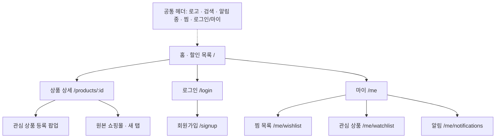

# 06. 화면 설계

## 1. 정보 구조 (IA)

## 2. 화면 목록

| ID | 화면 | 경로 | 로그인 | 요구사항 |
|---|---|---|---|---|
| SC-01 | 홈 (대시보드 + 할인 목록) | `/` | 불필요 | LIST-01~08 |
| SC-02 | 상품 상세 | `/products/:id` | 불필요 | DETAIL-01~07 |
| SC-03 | 관심 상품 등록 팝업 | (상세 위 팝업) | 필요 | WATCH-01~02 |
| SC-04 | 로그인 | `/login` | | AUTH-02 |
| SC-05 | 회원가입 | `/signup` | | AUTH-01 |
| SC-06 | 찜 목록 | `/me/wishlist` | 필요 | WISH-02~03 |
| SC-07 | 관심 상품 | `/me/watchlist` | 필요 | WATCH-03 |
| SC-08 | 알림 목록 (헤더 드롭다운 겸용) | `/me/notifications` | 필요 | NOTI-01~04 |

## 3. 주요 사용자 흐름

### 흐름 A: "이 할인 진짜야?" (핵심)
1. 홈에서 카드의 **신뢰도 배지**(예: 부풀림 의심)를 본다.
2. 카드를 눌러 상세로 간다.
3. 그래프에서 정가선(점선)과 실제 가격선이 멀리 떨어져 있는 것을 확인한다.
4. "정가로 팔린 날 0일 / 14일" 근거를 읽는다.
5. 구매하지 않고 관심 상품으로 등록한다.

### 흐름 B: 목표가 알림
1. 상세에서 **알림 받기**를 누른다. 비로그인이면 로그인 화면으로 갔다가 돌아온다.
2. 목표가를 입력하고 조건(목표가 이하, 역대 최저가 갱신)을 고른 뒤 저장한다.
3. 수집기가 하루 2회 조건을 검사해 알림을 만든다.
4. 헤더의 종 아이콘에 빨간 숫자가 뜨고, 누르면 알림 목록이 보인다. 알림을 누르면 상세로 이동한다.

### 흐름 C: 찜
1. 카드의 하트를 누르면 바로 채워진다. 비로그인이면 로그인 안내가 뜬다.
2. 마이 → 찜 목록에서 "찜한 뒤 ▼12,000원" 변화를 본다.

## 4. 화면별 구성

### SC-01 홈
| 영역 | 구성 |
|---|---|
| 헤더 | 로고, 검색창, 알림 종(배지), 찜, 로그인/마이 |
| 요약 띠 | "오늘 수집 32,410개 · 역대 최저가 1,204개 · 부풀림 의심 18%" |
| 필터 | 카테고리 탭, 플랫폼 체크, 정렬, "역대 최저가만", "부풀림 제외" |
| 목록 | 상품 카드 4열(PC) / 2열(모바일) |
| 카드 | 이미지, 플랫폼, 브랜드, 상품명, **현재가**, ~~정가~~ 표시 할인율, 역대 최저가, 신뢰도 배지, 하트 |
| 하단 | "비상업 학습 프로젝트 · 2026-11-14부터 수집" 안내 |

### SC-02 상세
| 영역 | 구성 |
|---|---|
| 상단 | 이미지, 브랜드, 상품명, 플랫폼, 하트, 원본 링크 |
| 가격 3종 | **현재가 / 정가 / 역대 최저가(날짜)**를 가로 3칸으로 |
| 신뢰도 카드 | 등급 배지, 표시 할인율과 실질 할인율 비교, 정가 판매일 비율, 계산 근거 |
| AI 한 줄 | "지금 사도 될까?" 요약 (OpenAI) |
| 그래프 | 7일/30일/전체, 판매가 선, 정가 점선, 역대 최저가 점 |
| 플랫폼 비교 | 같은 품번의 플랫폼별 현재가 |
| 알림 받기 | 버튼 → SC-03 팝업 |

### SC-03 관심 상품 팝업
- 목표가 입력 (기본값: 역대 최저가)
- 빠른 선택: "역대 최저가", "현재가 −10%"
- 체크박스: 목표가 이하일 때, 역대 최저가 갱신 시
- 저장 / 취소

### SC-04, 05 로그인과 회원가입
- 이메일, 비밀번호 (가입 시 비밀번호 확인과 닉네임 추가)
- 입력 칸 아래에 오류 문구 (예: "이미 가입된 이메일이에요")

## 5. 상태별 화면 (빈 상태, 오류)
| 상황 | 표시 |
|---|---|
| 검색 결과 없음 | "검색 결과가 없어요. 품번(예: DD1391-100)으로도 찾아보세요" |
| 찜 0개 | "마음에 드는 상품에 ♡를 눌러보세요" + 홈 버튼 |
| 데이터 부족 상품 | 신뢰도 자리에 회색 "수집 N일째" 배지 |
| 품절 | 이미지 흐리게 + "품절" 라벨, 가격은 마지막 가격 |
| 로딩 | 카드 모양 회색 자리표시(스켈레톤) |

## 6. 목업
디자인 대안 3종을 HTML로 만들었습니다: [`mockups/index.html`](../mockups/index.html)

anthropics/skills 저장소의 `frontend-design` 스킬(디자인 원칙)과 `theme-factory` 스킬(색과 글꼴 조합)을 참고했습니다. 이 스킬 기준으로 1차 목업은 흔한 AI 디자인 유형(검은 배경과 형광 초록, 크림색 배경과 세리프 글꼴, 신문 레이아웃)에 해당해서, 패션 매장의 실제 물건에서 출발해 다시 만들었습니다. 1차 목업은 `mockups/v1/`에 남겨 두었습니다.

| 대안 | 콘셉트 | 장점 | 단점 |
|---|---|---|---|
| **A. 가격 줄자** (`a-tape.html`) | 재단사의 줄자. 정가·평소 가격·지금 가격·최저가를 같은 눈금에 핀으로 표시하고, 정가와 평소 가격 사이를 빗금으로 칠한다 | 부풀린 할인이 길이로 보인다. 여러 상품을 나란히 비교하기 쉽다 | 줄자 읽는 법을 익혀야 한다. 쇼핑 느낌이 약하다 |
| **B. 세일 스티커** (`b-sticker.html`) | 행거에 걸린 가격택. 가격이 내릴 때마다 스티커를 덧붙인다. 정가 판매 기록 없이 붙은 스티커가 부풀림이다 | 매장 분위기라 둘러보는 재미가 있다. 콘셉트를 한 문장으로 설명하기 쉽다 | 정보가 많으면 산만할 수 있다 |
| **C. 가격 영수증** (`c-receipt.html`) | 계산대 영수증. 날짜별 가격을 영수증 줄처럼 찍고, 형광펜 줄 하나로 판정을 표시한다 | "기록으로 증명한다"는 서비스 성격과 맞다. 독특해서 기억에 남는다 | 고정폭 글꼴이 많아 읽기 피곤할 수 있다. 기간이 길면 접기가 필요하다 |

모든 목업에 홈, 상세(부풀림 의심, 진짜 할인), 로그인, 마이(관심 상품), 알림 목록, 관심 상품 등록 화면이 들어 있습니다.

> **디자인은 아직 확정하지 않았습니다.** 세 안을 비교한 뒤 결정하고, 결정 후 `07_디자인시스템.md`의 테마를 하나로 정합니다.
