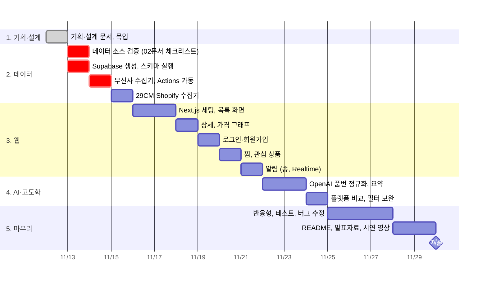

# 08. 일정 (WBS)

- 기간: 2026-11-12 (목) ~ **2026-11-30 (월) 제출 (확정)**
- 원칙: **수집기를 가장 먼저 돌린다.** 역대 최저가와 신뢰도는 기록이 쌓여야 의미가 있습니다. 11/14에 수집을 시작하면 제출일에 약 17일치가 쌓입니다. 신뢰도 판정 최소 기준은 7일입니다.

## 상세 작업표

| 번호 | 날짜 | 작업 | 산출물 | 완료 기준 |
|---|---|---|---|---|
| 1.1 | 11/12 | 기획, 요구사항, 설계, 디자인, 목업 3종 | `docs/`, `mockups/` | ✅ |
| 2.1 | 11/13 | 데이터 소스 검증 | 02문서 체크리스트 | 2곳 이상 수집 가능 확인 |
| 2.2 | 11/13 | Supabase 프로젝트 생성, `schema.sql` 실행 | DB | 테이블 9개 생성 |
| 2.3 | 11/14 | 무신사 어댑터, `main.py`, Actions | `crawler/` | **Actions 수동 실행 성공, DB에 상품 저장** |
| 2.4 | 11/15 | 29CM, Shopify 어댑터 | | 소스 2곳 이상 동시 수집 |
| 3.1 | 11/16~17 | Next.js, Tailwind, Supabase 연결, 목록 | `web/` | Vercel 배포 주소에서 목록 표시 |
| 3.2 | 11/18 | 상세, Recharts 그래프 | | 가격 3종과 그래프 표시 |
| 3.3 | 11/19 | 이메일 가입·로그인·로그아웃 | | 가입 후 profiles 행 생성 |
| 3.4 | 11/20 | 찜, 관심 상품 | | 다른 계정의 데이터가 안 보이는지(RLS) 확인 |
| 3.5 | 11/21 | 알림 목록, 종 배지, Realtime | | 목표가를 높게 잡아 알림이 오는지 확인 |
| 4.1 | 11/22~23 | OpenAI 품번 정규화, AI 요약 | `crawler/normalize.py` | 신규 상품 정규화 성공률 기록 |
| 4.2 | 11/24 | 플랫폼 비교, 필터 | | |
| 5.1 | 11/25~27 | 모바일 확인, 테스트, 버그 | 테스트 기록표 | 요구사항 M 항목 전부 통과 |
| 5.2 | 11/28~29 | README, 발표자료, 시연 영상 | | |
| 5.3 | 11/30 | 제출 | GitHub | |

## 위험과 대응
| 위험 | 가능성 | 대응 |
|---|---|---|
| 쇼핑몰이 크롤링을 막음 | 중 | 소스 교체(어댑터 구조), PC 작업 스케줄러로 실행, 최후에는 Apify |
| GitHub Actions(해외 IP)가 차단됨 | 중 | 본인 PC에서 하루 2회 실행 (02문서 5절) |
| 일정 지연 | 높음 | S, C 우선순위 기능부터 뺀다. 알림의 Realtime은 새로고침으로 대체 |
| 수집 기간이 짧아 신뢰도가 대부분 "데이터 부족" | 낮음 | 11/14 수집 시작을 꼭 지킨다 |
| OpenAI 비용 | 낮음 | 신규 상품만 처리, 결과는 DB에 저장해 다시 쓰기 |
