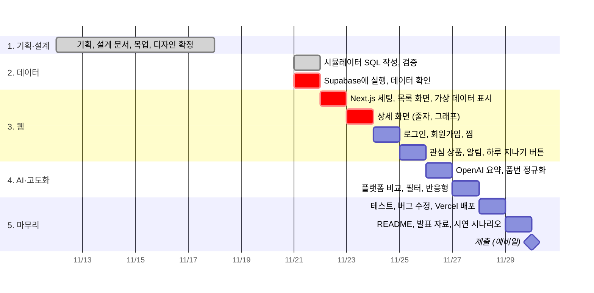

# 08. 일정 (WBS)

- 기간: 2026-11-12 (목) ~ **2026-11-30 (월) 제출 (확정)**
- **2026-11-21 방향 전환:** 실제 수집 대신 데모 시뮬레이터를 쓰므로, 수집 기간을 기다릴 필요가 없어졌습니다. 대신 남은 9일 안에 **웹 화면을 모두 만들어야** 합니다. 웹 구현이 일정의 핵심입니다.

## 상세 작업표

| 번호 | 날짜 | 작업 | 산출물 | 완료 기준 |
|---|---|---|---|---|
| 1.1 | 11/12~17 | 기획, 요구사항, 설계, 목업, 디자인 확정 | `docs/`, `mockups/` | ✅ 혼합안 확정 |
| 2.1 | 11/21 | 시뮬레이터 SQL 작성과 로컬 검증 | `supabase/002_simulator.sql` | ✅ 판정 171개 모두 기대와 일치 |
| 2.2 | 11/21 | Supabase에 `schema.sql`, `002_simulator.sql` 실행, `sim_seed()` | DB | `select count(*) from product_list;` 결과 171 |
| 3.1 | 11/22 | Next.js, Tailwind, Supabase 연결, 목록(스티커 가격택), 가상 데이터 표시 | `web/` | Vercel 주소에서 목록 표시 |
| 3.2 | 11/23 | 상세(가격 줄자, 날짜별 그래프, 판정 근거) | | 가격 3종과 줄자 표시 |
| 3.3 | 11/24 | 이메일 가입·로그인·로그아웃, 찜 | | 가입 후 profiles 행 생성, 다른 계정 데이터가 안 보임(RLS) |
| 3.4 | 11/25 | 관심 상품, 알림 목록과 종 배지, 하루 지나기 버튼 | | 버튼을 누르면 알림이 생기고 종 배지가 바뀜 |
| 4.1 | 11/26 | OpenAI: 한 줄 요약, 데모몰C 품번 정규화 | `web/app/api/` | 정규화 정확도 표 작성 |
| 4.2 | 11/27 | 플랫폼 비교, 필터와 정렬, 모바일 확인 | | 요구사항 M 항목 전부 통과 |
| 5.1 | 11/28 | 테스트, 버그 수정, Vercel 배포 | 테스트 기록표 | 배포 주소에서 전체 흐름 동작 |
| 5.2 | 11/29 | README, 발표 자료, 시연 시나리오 | | 시연 순서 리허설 |
| 5.3 | 11/30 | 제출 (예비일) | GitHub | |

## 직접 준비하실 것
| 항목 | 언제까지 | 비고 |
|---|---|---|
| Supabase 프로젝트와 SQL 실행 | 11/21 | `schema.sql` → `002_simulator.sql` → `select sim_seed();` |
| Vercel 계정 (GitHub로 가입) | 11/22 | 저장소를 연결하면 push할 때마다 자동 배포 |
| OpenAI API 키 (선불 5달러 정도) | 11/25 | 채팅에 붙여 넣지 말고 Vercel 환경변수에 직접 입력 |

## 위험과 대응
| 위험 | 가능성 | 대응 |
|---|---|---|
| 웹 구현이 밀림 (남은 기간이 짧다) | 높음 | S, C 우선순위부터 뺀다. 알림의 Realtime은 새로고침으로 대체, 플랫폼 비교는 마지막에 |
| 가상 데이터라는 점이 평가에서 약점이 됨 | 중 | 가상 데이터임을 숨기지 않고, 판정 로직과 시뮬레이터 설계(시나리오, 검증 결과)를 발표의 중심으로 둔다 |
| Supabase 무료 프로젝트가 7일 쉬면 정지됨 | 낮음 | 시연 전에 대시보드에 접속해 깨운다 |
| OpenAI 비용·오류 | 낮음 | 결과를 DB에 저장해 다시 묻지 않는다. 오류가 나면 저장된 요약을 보여준다 |
| 시연 중 하루 지나기가 4번 넘으면 변화 없음 | 낮음 | 시연 전 `sim_seed(90, true)`로 초기화하고, 시연 순서를 문서에 적어 둔다 |
